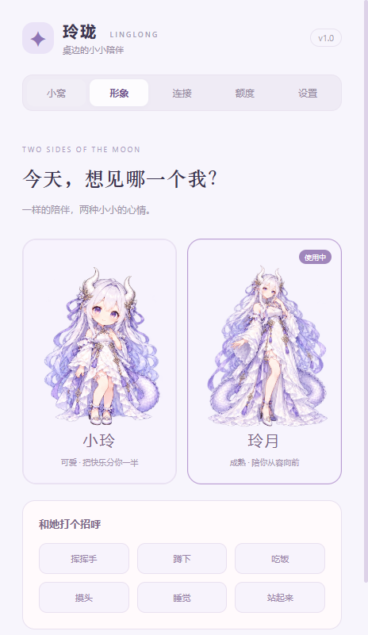

# ChatGPT 桌宠

银发、龙角和一点薰衣草色。住在 Windows 桌边，陪你连接 Nano、打开 Codex，也陪你休息一会儿。

独立开源项目，与 OpenAI、Nano 无隶属关系。

<p></p>

## 使用

从 [Releases](https://github.com/xzj828/linglong-codex-pet/releases) 下载 Windows 安装包，安装后打开「ChatGPT桌宠」。首次启动默认开启当前用户的开机自启动，可在设置或右键菜单关闭。退出桌宠不会关闭自启动；卸载会移除自启动项。

| 操作 | 效果 |
| --- | --- |
| 左键单击角色 | 检测 Nano → 连接当前默认节点 → 验证网络 → 打开 Codex 桌面应用 |
| 按住左键拖动 | 移动桌宠，自动记住位置 |
| 右键角色 | 切换形象、蹲下、吃饭、摸头、打招呼、睡觉、查看连接和额度 |
| 点击角色脚下的「ChatGPT」 | 打开小窝控制面板 |
| 系统托盘右键 | 互动、找回隐藏的桌宠、退出 |

两套形象：**可爱**与**成熟**，名字都叫 **ChatGPT**。工作时使用独立重绘的记笔记形象；任务失败或中断时，可爱形象哭泣擦泪，成熟形象轻轻低头、略显失落。搭配轻微呼吸、摇摆动画；「安静模式」可暂停动画。支持 25%–300% 大小、置顶、位置记忆及屏幕变化后的位置恢复。透明区域可穿透点击。气泡与角色独立排布，不遮住头部；小尺寸保持文字可读，大尺寸自动限制在当前屏幕工作区。

## Codex 工作状态

桌宠跟随本机 Codex 的工作状态：有任务时显示气泡与工作动作，任务完成时庆祝，失败或中断时切换难过形象。结果保留约 60 秒后恢复空闲、收起气泡；新任务开始会立即回到工作形象。空闲、未启动或无法确认任务时不常驻气泡，详细状态仍可在小窝面板查看。连接 Nano、打开 Codex 时也会短暂显示进度；摸头、吃饭等互动结束后自动回到当前任务状态。

状态来自本机 Codex 最近会话的生命周期事件，已跟踪会话约 2 秒更新一次，新会话发现最长约 10 秒，只提取状态标记，不展示或上传对话正文。多个会话同时工作时显示活动数量。没有可靠记录、记录过旧或检测失败时显示未知，不把应用已打开当成正在工作，也不把没有新日志当成任务完成。只覆盖本机写入会话记录的任务；远程主机及未落盘的状态不在监测范围内。

失败判定采用明确的终态标记，普通工具错误、网络重试不会直接触发难过形象，详见[事件契约与验证边界](docs/codex-activity-events.md)。

## Nano 与额度说明

- 自动寻找开始菜单中的 Nano 和 Windows 安装的 Codex 桌面应用，也可手动指定 exe。
- 保留 Nano 原有节点。只有进程、代理归属、通过代理到 ChatGPT 的有效 TLS 连接均通过，才显示连接成功。
- Nano 的某些版本需要管理员授权，Windows 可能显示 UAC。程序不会绕过 UAC，也不会创建提权计划任务。不同版本的自动连接能力与实际验证范围见 [集成说明](docs/integrations.md)。
- Codex 额度优先通过官方 `account/rateLimits/read` 读取，失败时查看本机最近会话中的额度快照。显示实际返回的窗口、剩余比例、重置时间；旧数据明确标识，不假设已重置为 100%。
- **Codex 配额不等于付费余额或 Nano 流量。** Nano 未开放已验证的流量查询接口，需在 Nano 中查看。缺失数据会显示未知。

## 开发

Windows 10/11，Node.js 24，npm 11。

```powershell
npm ci
npm start
npm test
npm run test:ui
npm run test:native
npm run dist
```

`npm run dist` 生成当前用户安装的 NSIS 安装包。Electron 第一次运行会下载二进制文件；网络需要代理时，在当前终端配置 `HTTPS_PROXY` 和 `NODE_USE_ENV_PROXY=1`，勿提交本机代理或凭据。

`test:ui` 启动独立测试配置的真实 Electron 窗口，验证两套素材、动作、设置、25%–300% 窗口缩放、工作/完成/失败/中断状态、气泡按任务显隐、结果到期恢复空闲、互动后恢复工作状态、IPC 拒绝非法动作和启动流程。测试将结果展示时间缩短到 5 秒；启动流程使用替身，不修改 Nano 连接或自启动。状态与额度页面会执行真实只读查询。截图位于被 Git 忽略的 `output/smoke/`。

`test:native` 在独立测试窗口中验证 Windows 原生鼠标输入：透明区域穿透、左键启动、拖动不误启动、右键菜单。它会短暂移动鼠标，点击前检查目标窗口归属，完成后恢复鼠标位置；同样不会修改 Nano 连接。

原生输入测试需要可交互、已解锁的 Windows 桌面；若 Windows 拒绝 `SetCursorPos`，测试会停止，不向其他窗口发送点击。

## 数据与安全

所有偏好保存在 `%APPDATA%/linglong-codex-pet/`，应用路径只保存在本机。桌宠不上传配置、会话或账户凭据，不读取 `auth.json`，不在渲染进程开放 Node.js。渲染页面只加载本地资源，IPC 采用固定动作和发送者校验。查询额度会短暂启动官方 Codex app-server，由官方进程使用已有登录状态；不发送模型任务。

## 素材与参考

- [任务结果形象提示词](docs/art-outcomes-v4.md)：可爱形象哭泣擦泪；成熟形象轻微失落、不流泪。
- [工作姿态重绘提示词](docs/art-working-v3.md)：可爱与成熟两张独立透明素材，拿笔记本记录灵感，不使用光球特效。

- [新版形象提示词与制作记录](docs/art-prompts-v2.md)：按用户提供的新三视图更新形象，并保留之前长裙的层叠特征，使用内置 imagegen 绘制两张透明 4×2 精灵表，没有复制其他桌宠仓库素材。
- [官方桌宠、开源项目与实现文档](docs/references.md)
- [Windows 集成细节与限制](docs/integrations.md)

代码采用 MIT 许可。角色图为 AI 生成素材；原始参考图未包含在公开仓库中。
